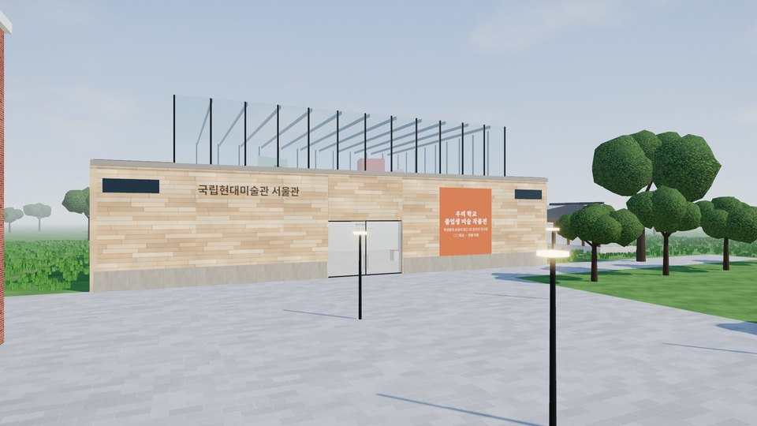

# 🏛 학생 작품 3D 온라인 전시관

구글 설문지로 학생 작품을 모으면, **지역 대표 미술관 12곳을 닮은 3D 전시관**에 학급별로 자동으로 걸어 주는 웹사이트입니다.
프로그램 설치 없이 인터넷 브라우저만으로 만들고, 무료 계정으로 운영할 수 있습니다.

---

## 🚀 우리 학교 전시관 만들기 — 3단계

### ① 구글 설문지 만들기 (5분)

> 📋 **가장 쉬운 방법: 설문지 사본 만들기**
> 👉 **[이 설문지의 사본 만들기](https://docs.google.com/forms/d/1h8prLlDhN4xaFhHoTvvUXYidbcIxvM9kD9KzJstJk18/copy)** 를 누르고 **사본 만들기**를 누르면, 질문이 모두 들어간 설문지가 내 구글 드라이브에 생깁니다.
> 제목과 설명만 우리 학교에 맞게 고치세요. (학교 구글 계정으로 로그인한 상태에서 눌러 주세요)

직접 만들려면 [forms.google.com](https://forms.google.com)에서 새 설문지를 만들고, 질문을 **이 순서대로** 넣습니다.

| 순서 | 질문 | 유형 |
|---|---|---|
| 1 | 학번 (필수) | 단답형 |
| 2 | 성명 (필수) | 단답형 |
| 3 | 작품1 제목 | 단답형 |
| 4 | 작품1 내용(설명) | 장문형 |
| 5 | 작품1 이미지 | 파일 업로드 (이미지만 · 1개 · 10MB) |
| 6~32 | 작품2 ~ 작품10 (제목 · 내용 · 이미지 반복, 필수 끄기) | |

- 학번 4자리 `3305` → 3학년 3반, 5자리 `31205` → 3학년 12반 전시실에 걸립니다.
설문지가 준비되면 (사본을 만든 경우에도 아래는 꼭 해 주세요)

- **응답** 탭 → **Sheets에 연결** → 새 스프레드시트를 만듭니다.
- **설정 → 응답**에서 **응답 횟수 1회로 제한**과 **제출 후 수정 허용**을 켭니다.
- 응답 시트와 사진 폴더(`설문지 제목 (File responses)`)를 **공유 → 링크가 있는 모든 사용자 · 뷰어**로 바꿉니다.

### ② 버튼 한 번으로 사이트 열기 (5분)

&envLink=https%3A%2F%2Fgithub.com%2FParkdongbae%2Fschool-3d-artcenter%23-%EA%B4%80%EB%A6%AC%EC%9E%90-%EB%B9%84%EB%B0%80%EB%B2%88%ED%98%B8%EC%99%80-%EC%A0%91%EA%B7%BC-%ED%82%A4)

1. 위의 **Deploy** 버튼을 누릅니다.
2. Vercel 계정이 없으면 **Continue with GitHub**로 가입합니다. (GitHub 계정이 없으면 [github.com](https://github.com)에서 먼저 무료로 가입하세요.)
3. 저장소 이름(Repository Name)을 정합니다. 예) `ourschool-art` — 사이트 주소가 됩니다.
4. **ADMIN_PASSWORD** 칸에 관리자 비밀번호를 적습니다. (학생이 모르는 것으로, 메모해 두세요)
5. **Deploy**를 누르고 1분 기다리면 `https://(이름).vercel.app` 주소가 생깁니다.

### ③ 사이트에서 "사이트 설정" (10분)

1. 새로 생긴 내 사이트를 엽니다. 첫 화면 위쪽의 **사이트 설정 시작** 버튼을 누릅니다.
2. **구글 시트 주소를 통째로 붙여넣고** → **연결 확인** (응답 수가 보이면 성공)
3. 전시 제목 · 부제 · 학교 이름 · 기간을 적고, 학교 로고를 고릅니다. (현수막 미리 보기가 바로 보여요)
4. 처음 한 번은 **GitHub 접근 키**가 필요합니다. 화면의 안내 버튼을 차례로 누르세요: 접근 키 만들기(미리 채워짐) → **Vercel 환경 변수 화면 열기** → **Add Environment Variable** → Key `GITHUB_TOKEN`, Value 붙여넣기 → **Save** → **Vercel 배포 화면 열기** → ⋯ → **Redeploy**
5. 관리자 비밀번호를 넣고 **저장하고 모든 기기에 적용** → 1~2분 뒤 새로고침하면 우리 학교 전시관이 됩니다. 🎉

---

## 🔑 관리자 비밀번호와 접근 키

| 이름 | 무엇인가요 | 어디에 |
|---|---|---|
| `ADMIN_PASSWORD` | 사이트 설정 저장·F9 관리 버튼을 누를 때 쓰는 비밀번호 | 배포할 때 입력 (Vercel → Settings → Environment Variables에서 바꿀 수 있음) |
| `GITHUB_TOKEN` | 사이트가 선생님 대신 GitHub에 설정·사진을 저장하도록 허락하는 열쇠 | 사이트 설정 화면의 안내 버튼으로 만들고, 안내의 **Vercel 환경 변수 화면 열기** → **Add Environment Variable** → Key `GITHUB_TOKEN` / Value 붙여넣기 → **Save** |

접근 키 만들 때 꼭 확인할 것: **Repository access → Only select repositories → 내 저장소 하나**, 권한은 **Actions · Contents · Workflows: Read and write** (안내 버튼으로 열면 미리 채워져 있습니다). 처음 저장할 때 사이트가 관리 기능(자동 작업 파일)을 저장소에 스스로 설치합니다. 키를 넣거나 바꾼 뒤에는 Vercel **Deployments → ⋯ → Redeploy**를 해야 적용됩니다.

---

## ✨ 기능

- 미술관 12곳 (서울·경기·인천·충북·전북·광주·대구·대전·경남·부산·강원·제주)의 건축을 모티프로 한 외관·로비·전시실
- 학번에 따라 학급별 전시실 자동 배치, 학생 이름표와 작품 나란히 전시
- 작품 크게 보기, 좋아요, 실명 감상평 (욕설·비속어 자동 차단)
- 감상평을 구글 시트 한 곳에 모으기 (F9 → 감상평 → "웹 앱 주소 만드는 방법"을 따라 Apps Script 주소를 만들어 넣기)
- 새 응답 자동 반영 (2분마다), 학생 많은 학교를 위한 사진 축소 저장
- 키보드 **F9** 관리자 메뉴: 사이트 설정, 작품 사진 업데이트, 모든 기기 자동 확인, 비속어 목록 관리, 감상평 내려받기
- 로비 배경음악(직접 합성), 화질 선택(낮음·높음·초고해상도), 휴대폰·태블릿 조이스틱

## ❓ 자주 묻는 질문

- **예시 작품이 보여요** → 아직 사이트 설정을 저장하지 않았거나, 시트 공유가 "링크가 있는 모든 사용자"가 아닙니다.
- **사진이 "불러오는 중"에서 안 바뀌어요** → 사진 폴더 `(File responses)` 공유를 확인하세요. 학생이 많으면 F9 → 작품 사진 업데이트를 누르세요.
- **저장 버튼에서 401 / 403 / 404** → 접근 키가 틀렸거나(401), 권한(Actions · Contents · Workflows 쓰기)이 부족하거나(403), 접근 키에 내 저장소를 선택하지 않았습니다(404). 화면의 안내 문구를 따라 주세요.
- **비용** → GitHub·Vercel 무료 계정으로 운영할 수 있습니다. (Vercel 무료는 월 전송량 100GB)

---

처음 만든 곳: 동신중학교 제50회 졸업생 미술 작품전 · 각 전시관은 실제 미술관의 건축적 특징을 참고한 교육용 가상 공간이며, 해당 미술관과 관계가 없습니다.
