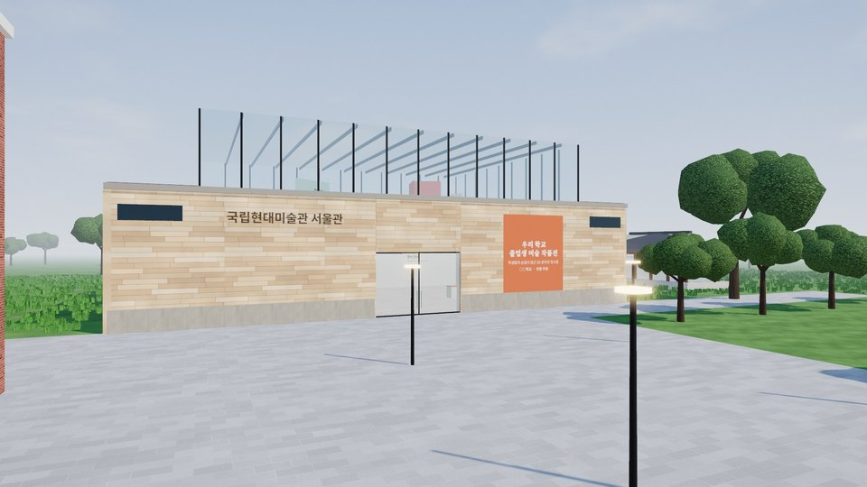

# 🏛 학생 작품 3D 온라인 전시관

구글 설문지로 학생 작품을 모으면, **지역 대표 미술관 12곳을 닮은 3D 전시관**에 학급별로 자동으로 걸어 주는 웹사이트입니다.

**가입·설치·코딩이 필요 없습니다.** 구글 계정만 있으면 10분 만에 우리 학교 전시관 주소가 만들어집니다.

---

## 🚀 우리 학교 전시관 만들기 — 딱 3단계

### 👉 [전시관 만들기 화면 열기](https://parkdongbae.github.io/school-3d-artcenter/?make)

위 링크를 누르면 나오는 화면에서 순서대로 따라 하면 됩니다. 화면 안에 필요한 버튼이 모두 들어 있습니다.

| 단계 | 할 일 | 걸리는 시간 |
|---|---|---|
| ① | **설문지 사본 만들기** 버튼 → 응답을 구글 시트에 연결 → 시트와 사진 폴더를 "링크가 있는 모든 사용자"로 공유 | 5분 |
| ② | **구글 시트 주소**를 붙여넣고 **연결 확인** | 1분 |
| ③ | **전시 제목·학교 이름**을 적고 **🎉 전시관 주소 만들기** | 2분 |

만들어진 **전시관 주소(또는 QR 코드)** 를 학생·학부모에게 알려 주면 끝입니다.
학생이 설문지에 작품을 내면 약 2분 안에 전시관에 자동으로 걸립니다.

> 📘 그림으로 따라 하는 **[선생님용 매뉴얼 (PDF 13쪽)](manual/teacher-manual.pdf)**
> 📄 글로 된 체크리스트: **[교사용 작업 지시서](docs/교사용-작업지시서.md)** (인쇄해서 옆에 두고 따라 하기 좋습니다)
> 📄 학생에게 나눠 줄 안내: **[학생 제출 안내문](docs/학생-제출-안내문.md)**

---

## ❓ 자주 묻는 질문

- **GitHub나 Vercel에 가입해야 하나요?** → 아니요. 위의 쉬운 방법은 구글 계정만 있으면 됩니다.
- **예시 작품이 보여요** → 구글 시트 공유가 "링크가 있는 모든 사용자(뷰어)"가 아닙니다. 만들기 화면의 **연결 확인**을 눌러 보세요.
- **사진이 안 보여요** → 구글 드라이브의 `설문지 제목 (File responses)` 폴더 공유를 "링크가 있는 모든 사용자(뷰어)"로 바꿔 주세요. 만들기 화면이 사진까지 확인해 알려 줍니다.
- **전시 제목을 바꾸고 싶어요** → 만들기 화면에서 다시 적고 주소를 새로 만들어 알려 주면 됩니다. (전시관에서 키보드 **F9** → **전시관 만들기 · 고치기**로도 열립니다)
- **주소가 너무 길어요** → 괜찮습니다. 복사·붙여넣기 하거나 QR 코드를 쓰세요. 학교 홈페이지에 링크로 걸어도 됩니다.
- **학번은 어떻게 적나요?** → 4자리 `3305` → 3학년 3반, 5자리 `31205` → 3학년 12반 전시실에 걸립니다.
- **학생 정보는 어디에 저장되나요?** → 선생님의 구글 시트와 드라이브에만 있습니다. 이 사이트는 그것을 읽어서 보여 주기만 합니다. 전시가 끝나 공유를 "제한됨"으로 되돌리면 더 이상 보이지 않습니다.
- **친구들과 같이 볼 수 있나요?** → 네. 미술관에 들어가 이름과 아바타를 고르면 같은 미술관에 있는 사람끼리 서로 보이고 대화할 수 있습니다. 주소를 만들 때 "함께 관람" 또는 "대화"를 꺼 둘 수도 있습니다.
- **복도 TV나 전자 칠판에 계속 틀어 두고 싶어요** → 전시관 주소 맨 끝에 `&auto=1#seoul` 을 붙여 여세요. 미술관으로 걸어 들어가 작품을 무작위로 계속 보여 줍니다. (`seoul` 자리에 `busan`·`jeju` 등 다른 미술관도 됩니다)
- **비용** → 무료입니다.

## ✨ 기능

- 미술관 12곳(서울·경기·인천·충북·전북·광주·대구·대전·경남·부산·강원·제주)의 건축을 모티프로 한 외관·로비·전시실
- 부드러운 그림자, 은은하게 비치는 바닥, 빛 번짐이 있는 사실적인 화면 (느린 컴퓨터에서는 자동으로 가볍게 바뀜)
- 로비의 큰 그림과 조형물 — 전시관을 꾸미려고 새로 만든 그림이며 실제 작가의 작품이 아닙니다
- 학번에 따라 학급별 전시실 자동 배치, 학생 이름표와 작품 나란히 전시
- **함께 관람**: 아바타 12가지 중 하나를 골라 친구들과 같은 미술관을 돌아다니고, 대화(채팅)하기 — 나쁜 말은 자동으로 가려지고 대화는 저장되지 않습니다
- **자동 관람**: ▶ 버튼 하나로 미술관에 걸어 들어가 작품을 무작위로 차례차례 감상 (직접 움직이면 바로 꺼짐)
- 작품 크게 보기, 좋아요, 실명 감상평(욕설·비속어 자동 차단)
- 새 응답 자동 반영(2분마다), 로비 배경음악, 화질 선택, 휴대폰·태블릿 조이스틱
- (선택) 학교 로고, 감상평을 구글 시트 한 곳에 모으기

## 🛠 더 필요한 분께

| 문서 | 누구에게 |
|---|---|
| [교사용 작업 지시서](docs/교사용-작업지시서.md) | 전시관을 만드는 선생님 (체크리스트) |
| [학생 제출 안내문](docs/학생-제출-안내문.md) | 학생·학부모에게 나눠 줄 안내 |
| [고급 설치 (Vercel)](docs/고급-설치-Vercel.md) | 학생이 아주 많거나(수백 명) 학교 전용 주소가 필요한 경우 |
| [개발 작업 지시서](docs/개발-작업지시서.md) | 이 프로그램을 고치는 개발자·AI 도우미 |
| [선생님용 매뉴얼 PDF](manual/teacher-manual.pdf) | 쉬운 방법을 그림으로 설명한 매뉴얼 (원고: `manual/teacher-manual.html`) |
| [예전 매뉴얼 PDF](manual/teacher-manual-advanced.pdf) | 고급 설치(Vercel) 방법을 그림으로 설명 |

---

처음 만든 곳: 동신중학교 제50회 졸업생 미술 작품전 · 각 전시관은 실제 미술관의 건축적 특징을 참고한 교육용 가상 공간이며, 해당 미술관과 관계가 없습니다.
